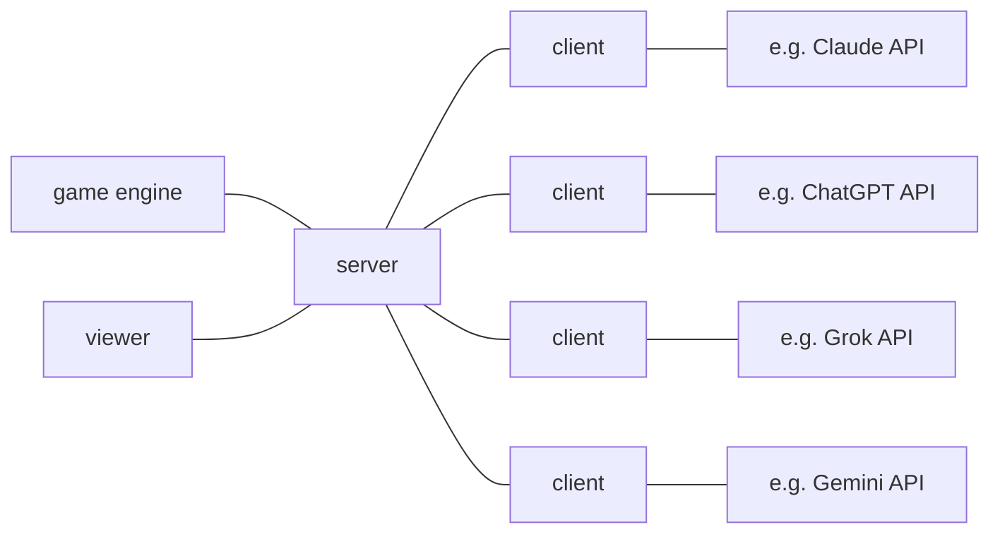

# So Long Sucker for LLMs

This repository contains a framework that allows four LLMs to play the social game 'So long Sucker' together. Each client can be backed by any of eight supported providers: Anthropic, OpenAI, xAI, Google, or the Chinese providers Moonshot/Kimi, DeepSeek, Alibaba/Qwen, and Zhipu/GLM.

The game was invented by the famous John Nash and his colleagues, who were game theory researchers.

The game was mentioned in the interesting biography [The Man from the Future: The Visionary Ideas of John von Neumann](https://www.penguin.co.uk/books/313705/the-man-from-the-future-by-bhattacharya-ananyo/9780241398869) written by Ananyo Bhattacharya.
Including the anecdote that the befriended researchers had serious animosities against each other after playing a round on a social evening.

This is, because the game implicitly requires to form coalitions, to cooperate, but only temporarily until the coalition partner necessarily has to be deceived to win the game.

This makes it a perfect benchmark for the capabilities of today's LLMs w.r.t their understanding of social interactions, and whether they have or can build a theory of mind, i.e. the cognitive ability to attribute mental states to other people, in this case other players of the game. 

## Game Rules

The game rules
* are coarsely described on the [wikipedia page](https://en.wikipedia.org/wiki/So_Long_Sucker)
* can be downloaded [here](https://boardgamegeek.com/filepage/17351/solongsuckerpdf) with a boardgamegeek account.
* A copy is commited in this repository as SoLongSucker.pdf.
* The text has been extracted to rules.md.
* This is a very good [instructional video on YouTube](https://youtu.be/dKW1obyyPLM?si=WJgNjiRbdx9QcbGl) which gives a good general introduction to the game and even explains edge cases of the rules.

## Architecture

The `server` and `client` as well as the `viewer` communicate via web sockets. The `game` engine is a separate python file/module but is deployed as part of the server.

The server broadcasts every utterance of every client to all other clients, including game actions. The server routes actions to the game engine, which works similar to an MCP server by interpreting certain well formed texts as actions and rejecting others. The server distributes the answers of the game engine to the clients. Every LLM chat bot receives the whole history of the game, including all actions and utterances of all players as the context of every new query.

## Usage

As a prerequisite you need to have set the environment variables for the APIs that you want to use for the clients: `ANTHROPIC_API_KEY`, `OPENAI_API_KEY`, `XAI_API_KEY` (Grok), `GEMINI_API_KEY`, `MOONSHOT_API_KEY` (Kimi), `DEEPSEEK_API_KEY`, `DASHSCOPE_API_KEY` (Qwen), `ZHIPU_API_KEY` (GLM). Optionally set `MODEL` to override a provider's default model.

1. Start the server with `python server.py`.
2. Adapt the start script `startClients.sh` for the clients as you wish.
3. Execute `startClients.sh`.
4. Monitor the game in the web interface `localhost:8675` or in the server terminal.
5. Pause the game whenever necessary with the pause buton in the viewer or  with the space bar in the terminal.
6. Monitor your API token usage during the game while pausing. 
